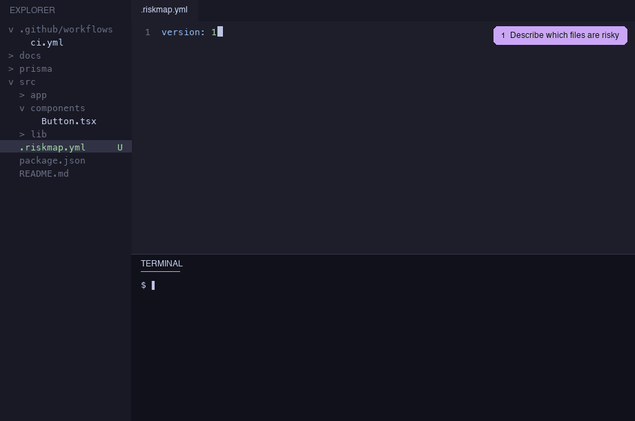

# Riskmap

**One small file that tells every tool which parts of your repository are risky to change.**

You write a `.riskmap.yml` that sorts your files into `low`, `medium` and `high` risk. The `riskmap` CLI then looks at a change (a pull request, a commit, a patch) and answers: *how risky is this, and why?* It answers in JSON, so your own scripts, bots and gates can build on it, or as a report for people.



```yaml
# .riskmap.yml
version: 1

default: { risk: high }        # no rule matches? treat it as risky

rules:
  - id: docs
    match: ["docs/**", "README.md"]
    labels: { risk: low }
    reason: "Documentation, no effect at runtime"

  - id: ci
    match: [".github/**"]
    labels: { risk: high }
    reason: "CI and gates must not loosen themselves"
```

```console
$ riskmap check --base main --format text
risk: high

  high    .github/workflows/ci.yml
          ci: CI and gates must not loosen themselves
  low     docs/setup.md
          docs: Documentation, no effect at runtime

riskmap: FAILED: 1 of 2 changed paths at risk "high" or higher (--fail-on high)
```

Why you might want this:

- **Review where it matters.** A typo fix in the docs and a change to the payment flow should not get the same amount of attention. That matters even more when AI agents write more code than people can read in full.
- **One source of truth.** The same file can feed your merge gate, your PR bot and your pre-commit hook. Riskmap only classifies; what happens at each level is up to the tool that reads the result.
- **Safe by default.** Anything you forgot to list gets the `default`. The rule file itself always counts as the highest level, so nobody can quietly lower the bar in the same pull request.

## Quick start

### 1. Install

Riskmap is a single binary without dependencies. Download the archive for your system from the [latest release](https://github.com/jdde/riskmap/releases/latest) (macOS, Linux and Windows, each for x64 and arm64), unpack it and put `riskmap` on your `PATH`. The release lists the SHA-256 of every archive in `checksums.txt`.

Or build it with Go 1.27 or newer:

```sh
go install github.com/jdde/riskmap/cmd/riskmap@latest
```

### 2. Add a `.riskmap.yml` to the root of your repository

Start from the example closest to your stack and adjust the paths:

| Stack | Rule file | Shows |
|---|---|---|
| Next.js, Prisma, NextAuth, Stripe | [`tests/examples/nextjs-web/.riskmap.yml`](tests/examples/nextjs-web/.riskmap.yml) | `except`, one file matched by two rules |
| Laravel API | [`tests/examples/laravel-api/.riskmap.yml`](tests/examples/laravel-api/.riskmap.yml) | a broad mild rule plus narrow strict rules, a custom ordered dimension |
| Flutter app | [`tests/examples/flutter-app/.riskmap.yml`](tests/examples/flutter-app/.riskmap.yml) | labels beyond risk: `domain` and `platform` |

A good first version has three kinds of rules: what is clearly harmless (docs, tests), what is ordinary (UI, application code) and what must never slip through (auth, payments, migrations, CI). Leave `default` at `high` and let everything else fall into it.

### 3. Check the file

```console
$ riskmap validate --format text
.riskmap.yml is valid: 8 rules, 9 tests passed
```

Mistakes are reported with their position, all at once:

```
.riskmap.yml:2:17: label "risk": "hihg" is not one of low, medium, high
.riskmap.yml:4:13: invalid glob "src/{a,b}/**": "{" is not allowed
```

### 4. Use it

Every command prints JSON unless you ask for `--format text`.

**On your machine**, to see what your branch touches:

```sh
riskmap check --base main --format text
```

**As a pre-commit hook** (`.git/hooks/pre-commit`), to stop before a risky commit:

```sh
#!/bin/sh
riskmap check --staged --fail-on high --format text
```

**In CI**, for example in GitHub Actions. The rule file is read from the point where the branch left `main`, so a pull request cannot relax the rules it is judged by. This needs the full history:

```yaml
- uses: actions/checkout@v5
  with:
    fetch-depth: 0
- uses: actions/setup-go@v6
  with:
    go-version: stable
- run: go install github.com/jdde/riskmap/cmd/riskmap@latest
- run: riskmap check --base "origin/${{ github.base_ref }}" --fail-on high --format text
```

**From your own tooling**, see the next section.

## Building on the output

The JSON result is the product; the text report is only a view of it. `riskmap classify` prints the classification, `riskmap check` prints the same document plus a verdict and sets the exit code.

```console
$ riskmap check --base main
```

```json
{
  "riskmap": 1,
  "status": "ok",
  "policy": { "ref": "4f2a…", "files": [{ "path": ".riskmap.yml", "sha256": "9c1e…" }] },
  "dimensions": {
    "risk": { "type": "ordered", "values": ["low", "medium", "high"] }
  },
  "labels": { "risk": "high" },
  "paths": [
    {
      "path": ".github/workflows/ci.yml",
      "labels": { "risk": "high" },
      "because": [
        { "kind": "rule", "config": ".riskmap.yml", "rule": "ci", "glob": ".github/**", "reason": "CI and gates must not loosen themselves" }
      ]
    },
    {
      "path": "docs/setup.md",
      "labels": { "risk": "low" },
      "because": [
        { "kind": "rule", "config": ".riskmap.yml", "rule": "docs", "glob": "docs/**", "reason": "Documentation, no effect at runtime" }
      ]
    }
  ],
  "check": { "fail_on": "high", "passed": false, "failing_paths": 1 }
}
```

What you can rely on:

- **One JSON document on standard output** for the exit codes 0, 1 and 3. Messages for people go to standard error. With exit code 2 (wrong usage, git failed) standard output is empty.
- **The same input gives the same bytes.** Keys have a fixed order, lists are sorted, there is no timestamp.
- **`status` tells you what you got.** `ok` and `incomplete` carry `labels` and `paths`. `no-config` and `invalid-config` carry no labels; treat them like the highest risk. `invalid-config` lists the problems under `errors`, each with `file`, `line`, `column` and `message`.
- **`dimensions` names the levels in order,** mildest first, so you can compare levels without parsing the rule file.
- **`because` explains every path:** the rule, the glob that matched and the `reason` you wrote.
- **A JSON Schema describes each document:** [`schema/result.schema.json`](schema/result.schema.json) for `classify` and `check`, [`schema/validate.schema.json`](schema/validate.schema.json) for `validate`. The tests of the CLI check its output against them. Later versions may add fields, so ignore the ones you do not know.

A few things to do with it, using [`jq`](https://jqlang.org):

```sh
# The overall risk as a plain word, for a shell script
riskmap classify --base main | jq -r '.labels.risk'

# Every path at "medium" or above, whatever the levels are called
riskmap classify --base main | jq -r '
  .dimensions.risk.values as $levels
  | .paths[]
  | .labels.risk as $risk
  | select(($levels | index($risk)) >= ($levels | index("medium")))
  | .path'

# A Markdown list for a pull request comment
riskmap classify --base main | jq -r '
  .paths[] | "- `\(.path)`: **\(.labels.risk)** (\(.because | map(.reason // .kind) | join("; ")))"'

# Fail closed in your own gate: anything but a clean result counts as high
risk=$(riskmap classify --base main | jq -r 'if .status == "ok" then .labels.risk else "high" end') || risk=high
```

## How rules work

- **All matching rules count, the strictest wins.** There is no "first match", so the order of your rules does not matter. A file matched by a `medium` rule and a `high` rule is `high`.
- **Unmatched paths get `default`.** Keep it at `high`.
- **`except` takes paths out of one rule.** There is no negation with `!`.
- **Renames count twice, deletions count.** Moving a file out of a protected folder is still a change to that folder.
- **Every rule needs a `reason`.** It shows up in the result, so a reviewer sees why a change was flagged.

Globs are deliberately simple:

| Pattern | Matches |
|---|---|
| `README.md` | only the file in the root, not `docs/README.md` |
| `src/*.ts` | `src/a.ts`, not `src/lib/a.ts` (`*` stays inside one directory) |
| `src/**` | everything below `src/` |
| `**/*.test.ts` | every `*.test.ts`, at any depth |
| `docs/**` | does not match `docs2/x.md` (patterns match the whole path) |

Dotfiles are matched like any other file, case matters, and `!`, `{}`, `[]` are not allowed.

### More than risk

`risk` is built in. You can declare labels of your own, and Riskmap merges them over all changed files:

```yaml
dimensions:
  domain:    { type: set }      # values are collected: [auth, payments]
  protected: { type: flag }     # true if any file sets it
  data:      { type: ordered, values: [none, internal, personal] }   # highest wins

rules:
  - id: payments
    match: ["src/lib/stripe.ts", "src/app/api/checkout/**"]
    labels: { risk: high, domain: [payments] }
    reason: "Payment flow"
```

### Tests inside the rule file

Pin down what you expect, so a later edit of the rules cannot change it unnoticed. `riskmap validate` runs them.

```yaml
tests:
  - path: "src/app/api/checkout/route.ts"
    expect: { risk: high, domain: [payments] }
  - path: "docs2/readme.md"          # near miss: not docs/
    expect: { risk: high }
```

## Commands

| Command | Purpose |
|---|---|
| `riskmap classify SOURCE` | Classify a change. Exit code 0 whatever the risk is. |
| `riskmap check [--fail-on LEVEL] SOURCE` | The same result plus a verdict. Exit code 3 if the change is at `LEVEL` (default `high`) or above. |
| `riskmap validate` | Check the rule file and run its `tests` block. |
| `riskmap help` | Full description of all options. |

All three print JSON by default and a report for people with `--format text`.

`SOURCE` says where the changed paths come from:

| Source | Paths | Rule file read from |
|---|---|---|
| `--base REF [--head REF]` | commits since the branch left `REF` | the branch point |
| `--staged` | what `git commit` would commit | the last commit |
| `--patch FILE` | a patch written by git (`-` for standard input) | the working directory |
| `PATH...` | the given paths | the working directory |
| *(nothing)* | NUL-separated paths from standard input | the working directory |

Options come before the paths: `riskmap check --fail-on medium src/a.ts`. Paths are written the way git writes them, relative and with `/`. A path written another way (`./src/a.ts`, `src/../a.ts`, `/src/a.ts`) is not matched against the rules and counts as the highest level, so that a different spelling cannot slip past a strict rule.

Exit codes: `0` success, `1` the rule file is missing or invalid, `2` wrong usage or a git error, `3` `check` reached the `--fail-on` level. A missing or broken rule file is never a pass.

## Status

Riskmap is a draft. The format is specified in [`SPEC.md`](SPEC.md) (v1, draft 0.2) and may still change.

Working today: `check`, `classify` and `validate` with a single rule file in the repository root. Not there yet: a GitHub Action, rule files in subdirectories of a monorepo (section 9 of the spec), and checks against the file tree such as "this glob matches nothing".

## Further reading

- [`SPEC.md`](SPEC.md): the exact definition of the format, the evaluation and the JSON result. Read this if you build a tool on top of Riskmap.
- [`docs/prior-art.md`](docs/prior-art.md): the survey of 53 existing tools and in-house scripts the design is based on, and where they disagree.
- [`tests/`](tests/README.md): the example projects with their expected results, which double as the acceptance tests of the CLI.
- [`CONTRIBUTING.md`](CONTRIBUTING.md): branch model (gitflow) and the checks every pull request has to pass.
- [`AGENTS.md`](AGENTS.md): how the code is organised, for contributors and coding agents.

## Development

```sh
go test ./...
go build ./cmd/riskmap
sh scripts/coverage.sh     # test coverage, must stay at 99 % or above
```

## License

See [`LICENSE`](LICENSE).
